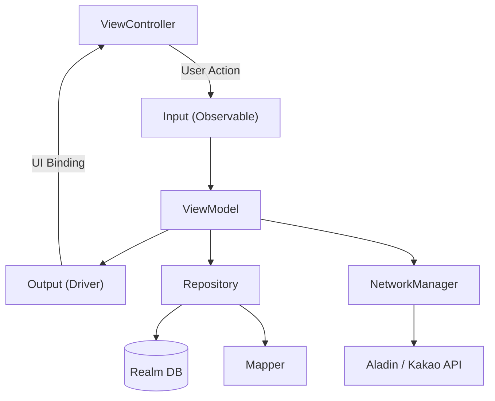
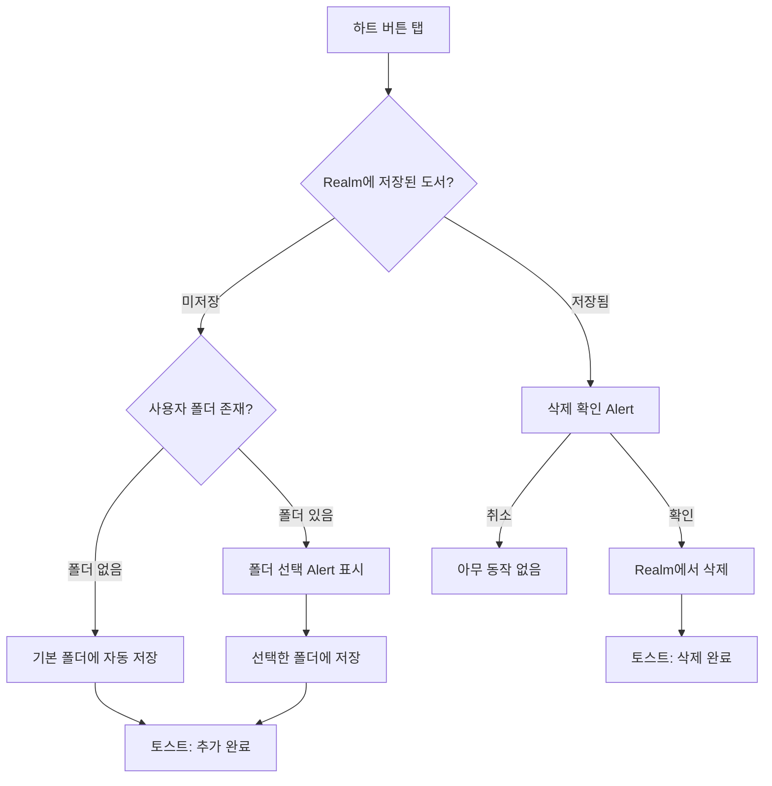
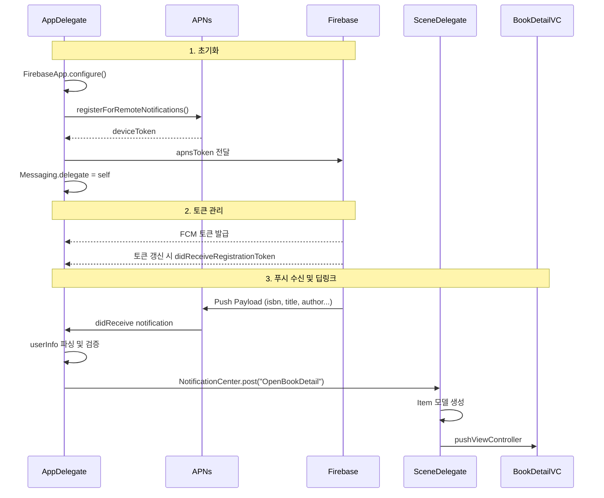

<p align="center">
  
</p>

<h1 align="center">BookMarker</h1>

<p align="center">
  도서 검색부터 독서 기록, 주변 독서 장소 탐색 그리고 맞춤형 폴더 관리까지 — 나만의 독서 생활을 한 곳에서 관리하는 iOS 앱입니다.
</p>

<p align="center">
  
  
  
  
  
  
  
  
</p>

---

## Screenshots

| 홈 | 도서 검색 | 도서 상세 |
|:---:|:---:|:---:|
|  |  |  |


| 독서 기록 | 독서 카드 | 내 파일 |
|:---:|:---:|:---:|
|  |  | 


| 주변 장소 지도 | 내 장소 | 장소 상세 |
|:---:|:---:|:---:|
|  |  |  |


---

## Tech Stack

| 분류 | 기술 | 선택 이유 |
|:---|:---|:---|
| **Architecture** | MVVM (Input/Output) | ViewController와 비즈니스 로직 분리, 테스트 용이성 확보 |
| **UI** | UIKit (Code-based), SnapKit | Storyboard 충돌 방지, 코드 리뷰 가능한 UI 구성 |
| **Reactive** | RxSwift / RxCocoa | 비동기 이벤트 스트림의 선언적 처리, UI 바인딩 단순화 |
| **Network** | Alamofire | URLRequestConvertible 기반 Router 패턴으로 엔드포인트 관리 |
| **Database** | RealmSwift | 로컬 영구 저장, 관계형 데이터(폴더-도서) 관리 |
| **Push** | Firebase Cloud Messaging | APNs 연동 원격 푸시 알림, 딥링크 네비게이션 |
| **Analytics** | Firebase Analytics | GoogleAppMeasurement 기반 앱 사용 데이터 자동 수집 |
| **Image** | Kingfisher | 비동기 이미지 로딩 및 디스크/메모리 캐싱 |
| **Map** | MapKit + CoreLocation | 주변 독서 장소 탐색, 카카오 로컬 API 연동 |
| **기타** | Then, Toast-Swift, IQKeyboardManager | UI 생성 DSL, 사용자 피드백, 키보드 처리 |

---

## Architecture

### MVVM (Input/Output) + Repository + Mapper



- **ViewModel**: `Input(Observable) → Output(Driver)` 변환만 담당. UI 이벤트를 수집하고 비즈니스 로직 처리 후 Driver로 UI를 갱신합니다.
- **Repository**: `BookRepository`, `FolderRepository`, `PlaceRepository`로 Realm 데이터 접근을 캡슐화하여 ViewModel이 Realm Object에 직접 의존하지 않도록 분리했습니다.
- **Mapper**: `BookMapper`, `PlaceMapper`를 통해 Realm Object ↔ Domain Model 변환을 중앙화하여, UI 계층에 DB 구현이 노출되지 않도록 합니다.

---

### 도서 즐겨찾기 저장 플로우 (3단계 분기 로직)



검색, 도서 상세, 지도 화면에서 동일한 즐겨찾기 로직을 사용합니다. ISBN13으로 Realm 저장 여부를 확인하고, 미저장 시 사용자 폴더 유무에 따라 기본 폴더 자동 저장 또는 폴더 선택 Alert을 분기합니다. 이 로직은 SearchViewModel, BookDetailViewModel, MapViewModel에서 동일한 패턴으로 구현하여 일관된 UX를 제공합니다.

---

### Firebase 원격 푸시 알림 플로우 (FCM 딥링크)



iOS의 Scene 기반 앱 생명주기에서 푸시 알림은 AppDelegate에서 수신하지만, 화면 네비게이션은 SceneDelegate의 `window`를 통해 이루어져야 합니다. `NotificationCenter`를 브릿지로 사용하여 두 계층 간 통신을 구현했고, `guard let` 체인으로 `type`, `isbn`, `title`을 순차 검증한 뒤 `BookDetailViewController`로 push합니다.

---

## Key Features

### 1. 홈 — 베스트셀러 무한 캐러셀 + 카테고리별 신간

알라딘 API의 베스트셀러, 신간, 카테고리별 도서 데이터를 표시합니다.
베스트셀러 섹션은 `UICollectionViewFlowLayout` 기반 무한 캐러셀로, 실제 데이터의 앞뒤에 복제 셀을 추가하여 끊김 없는 스크롤을 구현했습니다.
Timer 기반 자동 스크롤과 수동 드래그를 모두 지원합니다.

### 2. 도서 검색 — 페이지네이션 + 즐겨찾기

알라딘 검색 API로 도서를 검색하고, `prefetchItemsAt`을 활용한 무한 스크롤 페이지네이션으로 다음 페이지를 자동 로드합니다.
각 검색 결과에 하트 버튼이 있어 즐겨찾기(폴더 저장)가 가능하며, `viewWillAppear`마다 Realm 저장 상태를 갱신하여 다른 화면에서의 변경사항이 즉시 반영됩니다.

### 3. 독서 일기 — 카드 기반 독서 기록

도서별로 읽기 상태(읽는 중/완료), 시작·종료일, 별점, 메모, 인용문, 태그를 기록합니다.
인용문은 커스텀 스와이프 제스처(`UIPanGestureRecognizer` + `CGAffineTransform`)로 편집/삭제가 가능하고, 태그는 `frame` 기반 수동 Flow Layout으로 자동 줄바꿈을 처리합니다.

### 4. 내 서재 — 폴더 기반 도서/장소 관리

`UISegmentedControl`로 "내 서재"(도서 폴더)와 "내 장소"(장소 폴더)를 전환합니다.
각 폴더는 카드 UI로 표시되며, 내부에 수평 컬렉션뷰로 저장된 도서/장소 표지를 미리 보여줍니다.
폴더 CRUD(생성, 이름 수정, 삭제)를 지원하고, Realm의 `List<>` 관계와 `LinkingObjects` 역방향 참조로 폴더-도서 연결을 관리합니다.

### 5. 주변 장소 지도 — 카테고리 필터 + 즐겨찾기

MapKit + CoreLocation + Kakao Local API를 결합하여 반경 1km 내 카페, 도서관, 스터디카페를 검색합니다.
`combineLatest(위치, 카테고리)` + `debounce(0.3초)` + `flatMapLatest`로 위치/카테고리 변경 시 자동 검색하되 불필요한 중복 요청을 방지합니다.
장소도 도서와 동일한 폴더 저장 로직을 지원하며, 장소 상세 화면에서 카메라/갤러리로 사진을 촬영하여 로컬에 저장할 수 있습니다.

### 6. Firebase 원격 푸시 알림 — FCM 딥링크

Firebase Cloud Messaging을 통해 서버에서 전송한 원격 푸시 알림을 수신합니다.
푸시 페이로드에 도서 정보(ISBN, 제목, 저자, 표지 URL 등)를 포함하여, 알림 탭 시 해당 도서의 상세 화면으로 자동 이동하는 딥링크를 구현했습니다.
`UNUserNotificationCenterDelegate`로 Foreground/Background 모든 상태에서 알림을 처리하고, `MessagingDelegate`로 FCM 토큰 갱신을 감지합니다.
Firebase Analytics(GoogleAppMeasurement)를 통해 앱 사용 데이터를 자동 수집하여 사용자 행동을 분석합니다.

---

## Troubleshooting

### 1. 베스트셀러 무한 캐러셀 — 복제 셀 경계에서 역방향 스크롤 발생

**문제**
무한 캐러셀에서 마지막 → 첫 번째 또는 첫 번째 → 마지막으로 전환할 때, 의도한 방향과 반대로 순간 이동하는 현상이 발생했습니다. 복제 셀과 실제 셀의 경계에서 `scrollToItem`이 호출되면서 스크롤 방향이 뒤집히는 문제였습니다.

**원인**
`scrollViewDidEndDecelerating` 시점에 복제 셀 위치를 감지하여 실제 셀로 점프하는 로직에서, 스크롤 애니메이션이 진행 중일 때 위치 보정이 실행되면 방향 충돌이 발생했습니다.

**해결**
스크롤 애니메이션이 완전히 종료된 후(`scrollViewDidEndDecelerating`)에만 `animated: false`로 즉시 위치를 보정하여, 사용자에게 자연스러운 무한 스크롤 경험을 제공합니다.

```swift
func scrollViewDidEndDecelerating(_ scrollView: UIScrollView) {
    let index = Int(scrollView.contentOffset.x / scrollView.bounds.width)
    if index == 0 {
        collectionView.scrollToItem(at: realLastIndex, animated: false)
    } else if index == totalCount - 1 {
        collectionView.scrollToItem(at: realFirstIndex, animated: false)
    }
}
```

---

### 2. 위치 권한 복귀 시 지도 미작동 — PublishSubject의 구독 시점 문제

**문제**
위치 권한을 거부한 뒤 설정 앱에서 허용으로 변경하고 돌아와도, 지도에 현재 위치가 표시되지 않고 장소 검색이 동작하지 않았습니다.

**원인**
`PublishSubject<CLLocation>`은 구독 시점 이후에 방출된 이벤트만 전달합니다. 설정 앱에서 권한을 변경하면 `CLLocationManagerDelegate`가 위치를 방출하지만, 앱으로 복귀 후 `combineLatest`가 재구독하는 시점에는 이미 위치가 방출된 뒤이므로 `combineLatest`의 위치 스트림이 값을 갖지 못해 검색이 트리거되지 않았습니다.

**해결**
`ReplaySubject<CLLocation>.create(bufferSize: 1)`로 변경하여 마지막 위치를 버퍼에 보관하고, 새 구독자에게 즉시 전달하도록 수정했습니다. 추가로 `viewWillAppear`에서 `checkCurrentAuthorizationStatus()`를 호출하여 설정 복귀 시 권한 상태를 재확인합니다.

```swift
// Before: 구독 전 방출된 위치를 놓침
private let currentLocationSubject = PublishSubject<CLLocation>()

// After: 마지막 위치를 버퍼에 보관
private let currentLocationSubject = ReplaySubject<CLLocation>.create(bufferSize: 1)
```

---

### 3. Rx DisposeBag 생명주기 관리 — 셀 재사용 vs 동적 뷰 갱신

**문제**
두 가지 유형의 DisposeBag 생명주기 문제가 발생했습니다:
- **셀 재사용 시**: MapPlaceCell, SearchCollectionViewCell에서 하트 버튼의 Rx 구독이 `prepareForReuse()`에서 해제되지 않아, 셀 재사용 시 구독이 누적되어 한 번 탭에 여러 번 이벤트가 발생
- **동적 뷰 갱신 시**: LibraryViewController에서 세그먼트 전환 시 기존 BookCardView들의 Rx 구독이 해제되지 않아 메모리 누수 발생

**원인**
두 경우 모두 **뷰의 생명주기와 DisposeBag의 생명주기 불일치**가 근본 원인이었습니다. `let disposeBag`은 셀/뷰가 재사용되거나 교체되어도 같은 인스턴스를 유지하므로, 이전 구독이 계속 살아있었습니다.

**해결**
뷰의 생명주기 이벤트에 맞춰 DisposeBag을 재생성하는 패턴을 적용했습니다:

```swift
// 1. 셀 재사용: prepareForReuse()에서 재생성
final class MapPlaceCell: BaseCollectionViewCell {
    var disposeBag = DisposeBag()

    override func prepareForReuse() {
        super.prepareForReuse()
        disposeBag = DisposeBag()  // 이전 구독 자동 해제
    }
}

// 2. 동적 뷰 갱신: 뷰 재생성 시 배열 단위로 해제
private var cardViewDisposeBags: [DisposeBag] = []

private func createBookCardViews(with folders: [BookCardView.FolderBookData]) {
    bookCardViews.forEach { $0.removeFromSuperview() }
    bookCardViews.removeAll()
    cardViewDisposeBags.removeAll()  // 기존 DisposeBag 일괄 해제

    for folderData in folders {
        let cardDisposeBag = DisposeBag()
        // ... 바인딩은 cardDisposeBag에 등록
        cardViewDisposeBags.append(cardDisposeBag)
    }
}
```

---

### 4. FCM 딥링크 — Scene 기반 생명주기에서 AppDelegate ↔ SceneDelegate 간 네비게이션

**문제**
iOS 13+ Scene 기반 앱에서 푸시 알림은 AppDelegate에서 수신하지만, 화면 네비게이션을 위한 `window`와 `rootViewController`는 SceneDelegate가 관리합니다. AppDelegate에서 직접 NavigationController에 접근할 수 없어 푸시 알림 탭 시 올바른 화면으로 이동시킬 수 없었습니다.

**원인**
iOS 13 이전에는 AppDelegate가 `window`를 직접 소유했지만, Scene 기반 아키텍처에서는 `UIWindowScene`별로 SceneDelegate가 `window`를 관리하므로, AppDelegate에서 UI 계층에 접근하는 경로가 끊겼습니다.

**해결**
`NotificationCenter`를 브릿지로 사용하여 두 계층 간 통신을 구현했습니다. AppDelegate에서 `userInfo`를 `guard let` 체인으로 검증한 뒤 `"OpenBookDetail"` Notification을 post하고, SceneDelegate에서 Observer로 수신하여 `Item` 모델을 생성한 뒤 현재 활성 NavigationController로 `BookDetailViewController`를 push합니다.

```swift
// AppDelegate: 검증 후 전달
NotificationCenter.default.post(
    name: Notification.Name("OpenBookDetail"),
    object: nil,
    userInfo: userInfo
)

// SceneDelegate: Observer 등록 및 처리
NotificationCenter.default.addObserver(
    self,
    selector: #selector(handleOpenBookDetail(_:)),
    name: Notification.Name("OpenBookDetail"),
    object: nil
)
```

---

## Project Structure

```
BookMarker/
├─ Application/
│  ├─ AppDelegate.swift            # Firebase 초기화, FCM 토큰 관리, 푸시 알림 수신
│  └─ SceneDelegate.swift          # 탭바 구성, 푸시 딥링크 네비게이션
├─ Features/
│  ├─ Common/
│  │  ├─ Base/                     # BaseViewModel, BaseCollectionViewCell
│  │  ├─ Protocol/                 # DesignProtocol, ReusableProtocol
│  │  └─ Views/                    # FavoriteButton, StarRatingView
│  ├─ Home/                        # 베스트셀러 캐러셀, 카테고리별 신간
│  ├─ Search/                      # 도서 검색, 페이지네이션
│  ├─ BookDetail/                  # 도서 상세, 폴더 선택
│  ├─ BookDiary/                   # 독서 일기 작성/수정, 독서 카드 리뷰
│  ├─ Library/                     # 내 서재/내 장소, 폴더 CRUD
│  │  ├─ Views/                    # BookCardView, BookCoverCell, BookGridCell
│  │  ├─ FolderDetail/             # 도서 폴더 상세 (2열 그리드)
│  │  ├─ PlaceDetail/              # 장소 상세 (이미지, 별점, 연결 도서)
│  │  └─ PlaceFolderDetail/        # 장소 폴더 상세
│  └─ Map/                         # 주변 장소 지도 (MapKit + Kakao API)
├─ Network/
│  ├─ Base/                        # Router, NetworkManager, KakaoLocalRouter
│  ├─ Services/                    # KakaoLocalService
│  └─ Models/                      # Book DTO, KakaoPlace DTO
├─ Database/
│  ├─ Models/                      # BookRealmModel, FolderRealmModel, PlaceRealmModel
│  ├─ Mappers/                     # BookMapper, PlaceMapper
│  └─ Repository/                  # BookRepository, FolderRepository, PlaceRepository
├─ Utils/
│  ├─ Extensions/                  # UIColor+Hex, UIImageView+BookCover, PaddingLabel
│  └─ Managers/                    # ImageManager, LocationManager
└─ Resources/
   ├─ Assets.xcassets              # App Icon, Colors
   ├─ GoogleService-Info.plist     # Firebase 프로젝트 설정 (FCM, Analytics)
   └─ Info.plist
```

---

## License

이 프로젝트는 개인 포트폴리오 프로젝트이며, 상업적 사용을 금지합니다.
